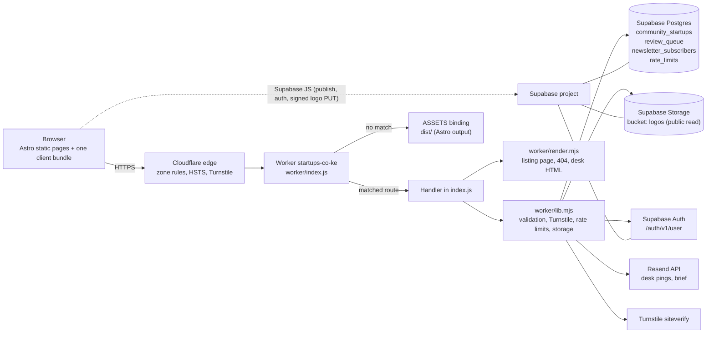

# Architecture — startups.co.ke

One page to answer “what handles this request, and where do I look when it breaks?”
Line numbers were checked on **2026-10-20**; function names are the stable anchor.

Refresh the index after refactors:

```powershell
Select-String -Path worker/index.js -Pattern "^(async )?function |^export default" | Select-Object LineNumber,Line
Select-String -Path worker/lib.mjs  -Pattern "^export (async )?function" | Select-Object LineNumber,Line
```

## 1. System map



Two backends, one writer:

- **Static pages** are built by Astro into `dist/` and served by the Worker's `ASSETS` binding. No runtime rendering except the listing pages below.
- **Everything dynamic** goes through `worker/index.js`. The browser never writes to Postgres with the anon key: RLS is on with no anon/authenticated policies, so only the Worker's service key can touch the tables.

## 2. Request routing

`worker/index.js:743` is the single entry point (`fetch`). Order matters: OPTIONS → GET/HEAD → POST → 405.

| Method | Path | Handler (index.js) | Auth | Touches | Cache |
| --- | --- | --- | --- | --- | --- |
| GET/HEAD | `/startups/community/list.json` | `handleList` :167 | none | `community_startups` | **never cached** (`no-store`): fresh on every read, see §8 |
| GET/HEAD | `/startups/community/<slug>` | `handlePage` :175 | none | `community_startups` | rendered per request, `no-store` |
| GET | `/startups/community/<slug>?format=md` | `handlePage` :175 | none | same | same, `text/markdown`, `noindex`, `no-store` |
| GET | `/desk`, `/desk/reset` | `deskHtml` (`render.mjs:267`) | none (shell only) | — | `no-store` |
| GET | `/desk/brief` | `handleBriefGet` :613 | desk session | `newsletter_subscribers`, `brief.mjs` | `no-store` |
| GET/POST | `/desk/data` | `handleDeskData` :568 | desk session | queue, listings, subscribers | `no-store` |
| POST | `/desk/brief-send` | `handleBriefSend` :637 | desk session | subscribers, Resend, queue (audit) | `no-store` |
| GET | `/api/health` | inline :791 | none | env booleans only | `no-store` |
| GET | `/api/my-listings` | `handleMyListings` :323 | bearer | `community_startups` (owner only) | `no-store` |
| GET/POST | `/api/unsubscribe` | `handleUnsubscribe` :717 | HMAC token | `newsletter_subscribers` | `no-store` |
| POST | `/api/startup-create` | `handleCreate` :218 | optional bearer + Turnstile | `community_startups`, `rate_limits` | `no-store` |
| POST | `/api/review-submit` | `handleReview` :414 | none | `review_queue`, `rate_limits` | `no-store` |
| POST | `/api/newsletter` | `handleNewsletter` :472 | none | `newsletter_subscribers`, `rate_limits` | `no-store` |
| POST | `/api/logo-upload-url` | `handleLogoUploadUrl` :531 | none (honeypot + cap) | Storage signed URL | `no-store` |
| POST | `/api/listing-update` | `handleListingUpdate` :358 | bearer (owner) | `community_startups`, `rate_limits` | `no-store` |
| * | anything else | `asset404` :144 → `ASSETS` | — | `dist/404.html` | `no-store`, `noindex` |

Legacy `/.netlify/functions/*` aliases still resolve for list, page, create, review and newsletter (client compatibility).
The old `POST /api/notify` is intentionally gone (open email relay).

## 3. End-to-end flows

### Publish a listing (anonymous or signed in)

1. Client opens the publish dialog → `ModalHost.astro` runs `loadTurnstile()` on first open (lazy, `challenges.cloudflare.com` is fetched only here).
2. Optional logo: `POST /api/logo-upload-url` (honeypot `company_url`, 20/day/IP, MIME + 2 MB caps) → `mintLogoUpload` (`lib.mjs:373`) returns a one-shot signed PUT + public URL. The browser PUTs the image straight to Storage.
3. `POST /api/startup-create` with `{...fields, turnstile, clientRef, logoUrl}`.
4. `handleCreate` order (this order is deliberate):
   honeypot (fake 200) → service-key guard (503) → optional user (`verifyUser`) → Turnstile-config guard (503 at the edge when the secret is missing, `:213`) → **Turnstile** (403, single-use token) → `validateListing` (422) → `clientRef` idempotency (200 duplicate) → rate limit 5 anon / 10 signed-in (429) → insert with unique slug, up to 5 attempts.
5. `bg()` sends a Resend ping to `DESK_EMAIL` (never blocks success).
6. Response gives `slug` + public URL; the client shows the success state.

### Edit / hide / republish (signed-in founder)

1. Auth dialog calls `GET /api/my-listings` with the Supabase access token.
2. `verifyUser` (`lib.mjs:116`) validates the token against `/auth/v1/user` **and requires a confirmed email**.
3. “Edit” opens `#modal-edit-listing`; submit → `POST /api/listing-update`.
4. `handleListingUpdate`: bearer (401) → slug (422) → ownership check (404, deliberately not 403) → 30 edits/day/IP (429) → action `unlist`/`republish` (status only) or `validateListing` + merge onto stored `data` (logo kept when not replaced).
5. `updateListingByOwner` (`lib.mjs:526`) scopes the PATCH by `slug` **and** `data->>userId`, so the query itself enforces ownership.
6. Pages are rendered per request, so the edit is visible on the next load.

### Other forms (claim, job, event, intro, issue, trial, buy, sponsor, register)

`POST /api/review-submit` → honeypot → kind allow-list → payload flattened/capped → 20/day/IP → `review_queue` insert → Resend ping. No auth, no Turnstile (these forms are the fallback path and replay from an offline queue).

### Newsletter + brief

Subscribe: `POST /api/newsletter` → `newsletter_subscribers` (unique email, duplicate is a friendly 200).
Unsubscribe: HMAC token (`unsubToken`), one-click via `/api/unsubscribe`, plus `List-Unsubscribe` headers on brief sends. Brief sending is desk-gated and requires `approve:true` for a list send.

### Desk

`/desk` is a static shell with an inline app; data comes from `/desk/data` (404 when the session is not `DESK_EMAIL`). Actions: unlist / restore / delete a listing, mark a queue row done. Deletes are the only destructive action; everything else is a status change kept for audit.

## 4. Data and storage

| Store | Contents | Access |
| --- | --- | --- |
| `community_startups` | founder listings; `slug` column is the source of truth, the record lives in `data` JSONB (`userId`, `clientRef`, content) | Worker service key only (public reads via the Worker) |
| `review_queue` | every non-listing submission (`kind`, `label`, `payload`, `email`, `status`) | Worker service key only |
| `newsletter_subscribers` | one row per email | Worker service key only |
| `rate_limits` | `(ip, day, n)` counters; single bucket per IP/day, caps differ per endpoint | Worker service key only |
| Storage `logos` | uploaded images, public read | public read; **no insert policy** — signed PUT minted by the Worker |

`tools/schema.sql` is the original design sketch (it still lists tables that never went live). The tables above are what the Worker actually queries; treat the Worker code as the schema source of truth.

## 5. Configuration

Non-secret vars ship in `wrangler.jsonc`; secrets live only in the Cloudflare dashboard (or `wrangler secret put`).

| Name | Kind | Missing behaviour |
| --- | --- | --- |
| `PUBLIC_SUPABASE_URL`, `PUBLIC_SUPABASE_ANON_KEY` | var | hardcoded fallback in `lib.mjs` |
| `PUBLIC_TURNSTILE_SITE_KEY` | var | client falls back to the compiled key (`src/lib/supabase.ts`) |
| `SUPABASE_SERVICE_ROLE_KEY` | secret | writes answer 503; `/api/health` reports `storage:false` |
| `RESEND_API_KEY` | secret | email no-ops, DB is still written; `email:false` |
| `DESK_EMAIL` | secret | desk **fails closed** (404 everywhere), no notification recipient |
| `TURNSTILE_SECRET` | secret | publish answers **503** (fail closed); only the explicit `TURNSTILE_SKIP=1` switch (local `wrangler dev`) skips the check |
| `RESEND_FROM` | secret/var | defaults to `startups.co.ke <notices@startups.co.ke>` |
| `PUBLIC_ANALYTICS_DOMAIN` | var | analytics script not loaded |

`GET /api/health` returns booleans only: `{ok, storage, email, anon, turnstile}`.

## 6. Client map

| File | Owns |
| --- | --- |
| `src/scripts/core.ts` | scroll reveals, auth landing (hash links + recovery), session chip, “compiled from public sources” chip, email de-obfuscation, cookie consent |
| `src/components/ModalHost.astro` | every `<dialog>`: publish, claim, edit listing, auth + “Your listings”, post job, newsletter; form submission, logo upload, Turnstile lazy loader |
| `src/lib/supabase.ts` | Supabase client, `TURNSTILE_SITE_KEY`, `turnstileToken()`, `uploadLogo()`, `publishListing()`, `postListingUpdate()`, `submitForm()` fallback queue |
| `src/config/site.ts` | nav, contact (email/phone/WhatsApp), pricing, disclaimers — one source for every page |
| `src/data/*.ts` | typed, sourced datasets; pages derive all counts and tables from these |
| `src/content/news/*.md` | editorial articles (zod schema in `src/content.config.ts`) |

## 7. Triage: symptom → where to look

| Symptom | Look first | Usual cause |
| --- | --- | --- |
| Publish returns **403** “Verification failed” | `lib.mjs:409` `verifyTurnstile`; `TURNSTILE_SECRET` | token was already spent (retry reuses it), widget never rendered, or secret/site key belong to different Turnstile widgets |
| Publish returns **429** | `lib.mjs:140` `checkRateLimit`; `rate_limits` rows | shared office NAT, or a bot burned the cap — check `ip`/`day` |
| Publish returns **503** | `handleCreate:227` service-key guard, `:235` Turnstile-config guard | `SUPABASE_SERVICE_ROLE_KEY` or `TURNSTILE_SECRET` missing in the Worker env — `/api/health` shows which |
| Publish **422** | `validateListing` (`lib.mjs:307`) | field too short/long, non-https website, bad email; response carries per-field `errors` |
| Duplicate listing on retry | `findByClientRef` / `clientRef` | client must send the same `clientRef` for the same form session |
| Listing page **404** after publish | `handlePage:190` status filter | row `status != 'published'` (unlisted/soft-deleted) |
| Edit says “not under your account” | `handleListingUpdate:373` | row has no `data->>userId` (anonymous publish) — desk must link it first |
| Edit or hide does nothing | `updateListingByOwner` return | PATCH matched 0 rows → wrong `userId`; it fails closed by design |
| Logo missing | `uploadLogo` (client) → `/api/logo-upload-url` → `mintLogoUpload` | oversized/unsupported file, 20/day cap, or Storage bucket policy changed |
| Email not delivered | `attemptEmail` (`lib.mjs:173`), `RESEND_API_KEY`, `RESEND_FROM` | unverified sender domain, missing key, or Resend quota; the DB write still succeeded |
| Desk returns 404 | `deskGuard:562` | session email ≠ `DESK_EMAIL`, or `DESK_EMAIL` unset (fails closed) |
| Desk shows stale queue | `queueList` | it reads live; check the row `status` (done rows stay) |
| Brief send refused | `handleBriefSend` | list send requires `approve:true`; desk session required |
| Unsubscribe link fails | `unsubValid` (`lib.mjs:266`) | token signed with a different secret, or email not in the table |
| Community list empty | `handleList:167` | service key missing (returns `notice`), or every row is unlisted |
| **A new listing does not appear on the directory** | §8 invariant 8; `handleList:167` | the feed is read fresh and sent `no-store`; if a listing is missing, the row is not `published` (or the slug is not in the feed). If it appears in `list.json` but not on the page, the browser is showing a cached page — hard-reload; the page is `no-store`, so a reload must show it |
| Old content after edit | routing comment `index.js:763` | the page is rendered per request and sent `no-store`; the only way to still see old content is a Cloudflare cache rule that caches HTML above the origin headers |
| Build fails / mixed lockfiles | repo root | `bun.lock` must be the only lockfile (Cloudflare builds with bun) |
| Wrong fonts / OG images | `Seo.astro`, `public/fonts/`, `public/og/` | assets are immutable-cached: bump the filename |

## 8. Invariants (do not break)

1. **Service key never reaches the browser.** Only the Worker uses it; `worker/lib.mjs` is the only place it is read.
2. **Ownership is enforced in SQL, not just in JS.** Any new listing mutation must scope by `slug` AND `data->>userId`.
3. **Turnstile tokens are single-use.** Verify once, on the final write (`/api/startup-create`). Do not add a second verify for the same token (e.g. logo mint + create). The client must reset the widget after a failed attempt (`resetTurnstile` in `ModalHost.astro`) — the widget keeps showing green on a spent token, so a retry without a reset fails with 403.
4. **Forms degrade honestly.** Without Supabase config they queue locally and say so; email failures never block a stored record.
5. **404 vs 403.** Non-owners and non-desk users get 404 so endpoints never confirm a record exists.
6. **No secrets or personal contact details in the repo.** They live in Cloudflare secrets and `/contact`.
7. **Rate limits run after validation**, so a fixable typo never burns the day’s allowance; the bot check runs before the counter.
8. **Never let a browser cache a founder-visible response.** This zone’s Cloudflare **Browser Cache TTL is 14400 (4 h)** and Cloudflare rewrites any positive origin `max-age` up to it ("Cloudflare respects whichever value is higher: the Browser Cache TTL in Cloudflare or the `max-age` header"). A `max-age=60` feed therefore reached browsers as `max-age=14400`, and a newly published listing stayed invisible to repeat visitors for hours. Purging the CDN does **not** clear a copy a visitor’s browser already holds, so a purge can never fix it. The listing feed, the listing pages and the `?format=md` variant therefore send `Cache-Control: no-store`, the feed is read fresh from Supabase on every request, and the client fetches it with `cache: 'no-store'`. If you add caching back, use `Cloudflare-CDN-Cache-Control` (edge-only) and keep the browser-facing directive at `no-store`.

## 9. Verify before you push

```powershell
bun run check   # astro check: TS + .astro types
bun run test    # 70 assertions, no network: unit_s7 (routing/render/desk), unit_s8 (validation/limits/edge config), unit_logo
bun run build   # fetch_jobs.mjs + astro build (rewrites src/data/jobs.live.json)
```

End-to-end against real storage (writes QA rows; clean them up afterwards):

1. Put `SUPABASE_SERVICE_ROLE_KEY` and `DESK_EMAIL` in `.dev.vars` (gitignored).
2. Run `wrangler dev` with a config that has **no `build.command`**: the build step rewrites `src/data/jobs.live.json`, which re-triggers the rebuild and loops forever.
3. Proof-of-human gate: put `TURNSTILE_SKIP=1` in `.dev.vars` to skip the check locally (production never sets it), or use the always-pass Turnstile test pair — site `1x00000000000000000000AA`, secret `1x0000000000000000000000000000000AA`. Never put a test key in `wrangler.jsonc`.
4. `node scripts/e2e_launch.mjs` — 17 checks: anon publish → page renders → signed-in publish → edit is live → hide → republish → 422 shape → 403 without token.

The other `scripts/e2e_*`, `shot_*`, `vlm_*`, `overflow_*` files are one-off session scripts kept for provenance; `e2e_auth`, `e2e_listing_edit`, `e2e_logo` and the `unit_*` trio are the ones still maintained.

## 10. Deploy and rollback

| What | How |
| --- | --- |
| Deploy | `git push origin main` → Cloudflare Workers git integration builds with bun and releases Worker `startups-co-ke` (~2 min). Manual: `bunx wrangler deploy` with `CLOUDFLARE_API_TOKEN`. |
| Secrets | `bunx wrangler secret put TURNSTILE_SECRET` (same for `RESEND_API_KEY`, `SUPABASE_SERVICE_ROLE_KEY`, `DESK_EMAIL`, `RESEND_FROM`). Dashboard → Worker → Settings → Variables. |
| Rollback | Dashboard → Worker → Deployments → **Rollback** to a previous version (instant, no rebuild), or `git revert` the commit and push. |
| Data job | `.github/workflows/refresh-data.yml` runs daily at 03:00 UTC (06:00 EAT), rewrites `src/data/jobs.live.json` and pushes — that push is itself a deploy. |
| Post-deploy check | `curl https://startups.co.ke/api/health` → `{"ok":true,"storage":true,"email":true,"anon":true,"turnstile":true}`; `curl -X POST https://startups.co.ke/api/startup-create` with an empty body → **403**; open one community page and one `?format=md`. |

Production facts: Worker `startups-co-ke` (custom domain bound in the dashboard, not in `wrangler.jsonc`), Supabase project `eezqpsbhmnhuhnmiwnsz` in `eu-west-2`, Turnstile widget `0x4AAAAAAFb9FAfoXKvdJ2o4`, Resend domain `startups.co.ke` (region `eu-west-1`, sending verified, `notices@` sender).

Zone cache settings (Cloudflare dashboard → Caching → Configuration): **Browser Cache TTL = 14400 (4 h)**. That is why every founder-visible response carries `no-store` (§8, invariant 8). Keep the `no-store` even if the zone is later set to "Respect existing headers" — a copy already sitting in a visitor's browser is what strands a stale listing, and no purge can reach it. Note: the API token in `.secrets.env` can read the zone but cannot write cache settings or purge (`browser_cache_ttl` → 400, `purge_cache` → 401), so changing it is a dashboard action.

## 11. Known gaps (accepted for now)

- `rate_limits` is one bucket per IP/day shared by every endpoint, so heavy editing can consume the publishing allowance and vice versa.
- The custom domain is bound in the dashboard; a fresh deploy from a new account would need that step re-done.
- `docs/SPEC.md` is a research/notes archive, not the product spec (see `README.md`).

